# Technical Report — Network Segmentation and Redundancy

## 1. Обзор проекта

Данный проект посвящён настройке, укреплению и исследованию сетевой инфраструктуры с использованием GNS3 и Cisco IOS.

В ходе работы реализованы четыре практических сценария:

1. VLAN — сегментация локальной сети и усиление безопасности trunk-соединений.
2. EtherChannel — агрегация физических интерфейсов между коммутаторами.
3. OSPF — динамическая маршрутизация между несколькими маршрутизаторами.
4. HSRP — резервирование шлюза и проверка переключения между маршрутизаторами.


## 2. Лабораторное окружение

Работа выполнялась в GNS3 с использованием виртуальных сетевых устройств Cisco.

| Компонент | Назначение |
|---|---|
| GNS3 | Моделирование сетевых топологий |
| Cisco 3745 | Маршрутизаторы и коммутаторы |
| Cisco IOS CLI | Настройка и диагностика оборудования |
| VPCS | Виртуальные конечные устройства |

Для каждой лабораторной работы создан отдельный проект GNS3. Для VLAN дополнительно сохранены две версии конфигурации: базовая и усиленная.

---

## 3. VLAN Configuration and Security

### 3.1. Цель

Создать виртуальные локальные сети на базе двух коммутаторов и четырёх виртуальных компьютеров, настроить передачу трафика между коммутаторами через trunk-соединение и изучить дополнительные меры защиты от VLAN Hopping.

### 3.2. Топология

В лабораторной работе использовались два коммутатора Cisco SW1 и SW2, соединённые trunk-каналом.

К каждому коммутатору подключены два виртуальных компьютера VPCS.

Логическое распределение устройств:

| Устройство | Коммутатор | VLAN |
|---|---|---|
| PC1 | SW1 | VLAN 10 |
| PC2 | SW1 | VLAN 20 |
| PC3 | SW2 | VLAN 10 |
| PC4 | SW2 | VLAN 20 |

Созданы две VLAN:

- VLAN 10 — Sales.
- VLAN 20 — IT.

**Топология:**

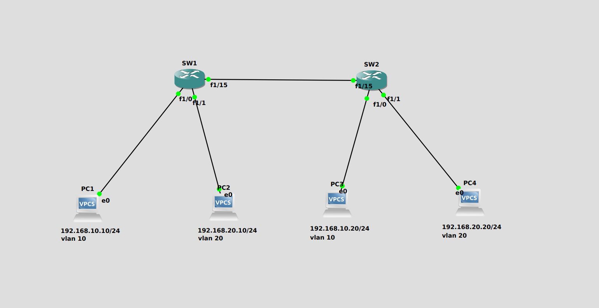

### 3.3. Базовая конфигурация

На обоих коммутаторах созданы VLAN 10 и VLAN 20.

Конечные устройства подключены к access-портам в соответствии с их VLAN.

Для соединения SW1 и SW2 настроен trunk с использованием IEEE 802.1Q.

Основные команды, использованные при проверке:

```text
show vlan-switch brief
show interfaces trunk
```

С помощью этих команд проверены созданные VLAN, принадлежность портов к соответствующим сегментам и состояние trunk-соединения.

**Проверка состояния VLAN и trunk:**

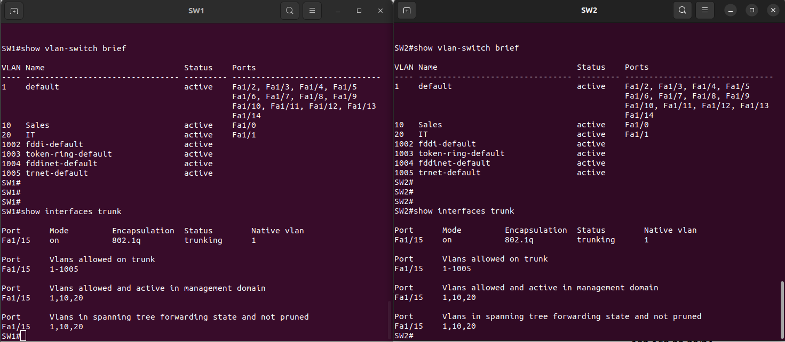

### 3.4. Проверка связности

Для проверки передачи трафика между коммутаторами выполнены ICMP-запросы между устройствами, находящимися в одинаковых VLAN.

Результаты:

- PC1 ↔ PC3 — успешный обмен ICMP-пакетами.
- PC2 ↔ PC4 — успешный обмен ICMP-пакетами.

**Результаты проверки:**

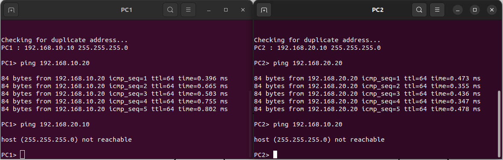

### 3.5. Усиление безопасности VLAN

Дополнительно создана отдельная версия проекта с изменённой конфигурацией trunk.

В качестве меры защиты изменена native VLAN с VLAN 1 на VLAN 999. Для неё задано имя `Native_Unused`.

Использованные настройки trunk:

```text
interface FastEthernet1/15
 switchport trunk native vlan 999
 switchport mode trunk
```

Настройки применены на обоих коммутаторах.

Проверка выполнена командами:

```text
show running-config interface f1/15
show vlan-switch brief
show interfaces trunk
```

В результатах проверки подтверждены:

- Native VLAN 999 на обоих концах trunk.
- Рабочее состояние trunk.
- Наличие VLAN 10 и VLAN 20.
- Передача трафика соответствующих VLAN через trunk.

**Проверка усиленной конфигурации:**

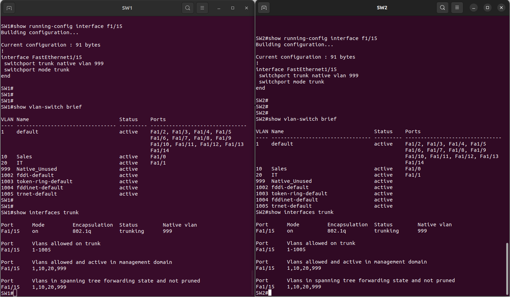

### 3.6. Результат

Созданы две версии лабораторного проекта:

- `vlan.gns3project` — базовая конфигурация VLAN.
- `vlan-hardened.gns3project` — конфигурация с изменённой native VLAN.

Изучены принципы сегментации сети, работы access- и trunk-портов, а также одной из мер снижения риска VLAN Hopping.

---

## 4. EtherChannel Configuration

### 4.1. Цель

Реализовать агрегацию физических интерфейсов между двумя коммутаторами, чтобы объединить несколько физических соединений в один логический канал.

### 4.2. Топология

За основу взята топология предыдущей лабораторной работы с двумя коммутаторами SW1 и SW2 и четырьмя виртуальными компьютерами.

Для соединения коммутаторов используются два физических интерфейса на каждой стороне, объединённые в EtherChannel.

**Топология:**

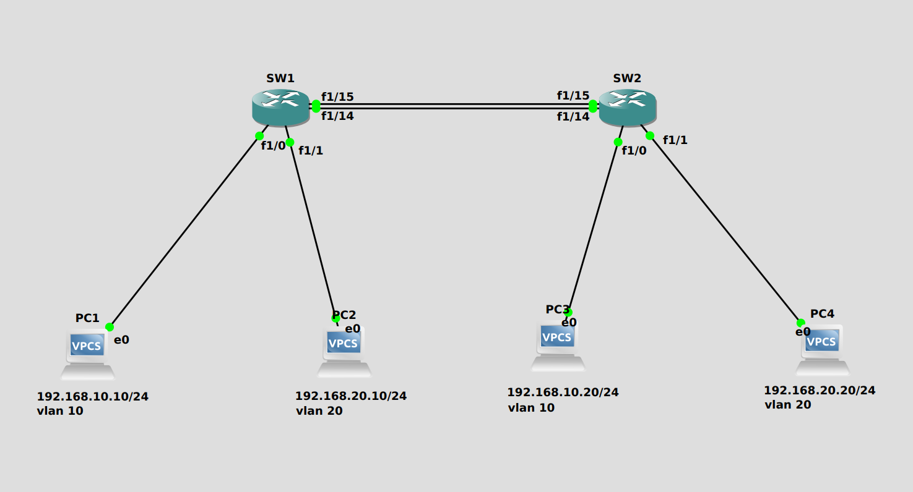

### 4.3. Настройка EtherChannel

Два физических интерфейса на каждом коммутаторе объединены в логический интерфейс Port-channel 1.

На логическом интерфейсе настроен trunk для передачи трафика VLAN.

Для проверки использовалась команда:

```text
show etherchannel summary
```

В результате на обоих коммутаторах обнаружен Port-channel 1 в рабочем состоянии.

В выводе команды:

- `S` — Layer 2 EtherChannel.
- `U` — логический канал используется.
- `P` — физический интерфейс включён в агрегированный канал.

**Состояние EtherChannel:**

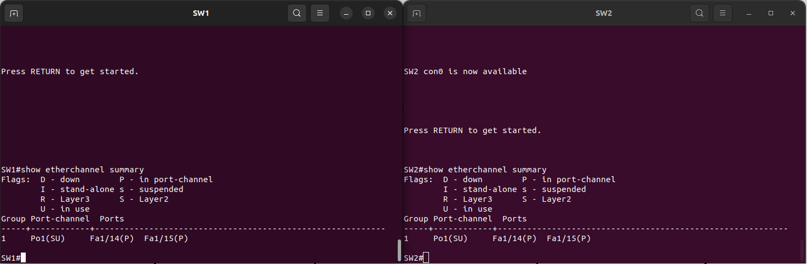

### 4.4. Проверка trunk

Для проверки логического канала и его параметров использованы команды:

```text
show interfaces trunk
show running-config
```

Проверено, что trunk работает через логический интерфейс Port-channel 1 и передаёт трафик VLAN.

**Результаты проверки:**

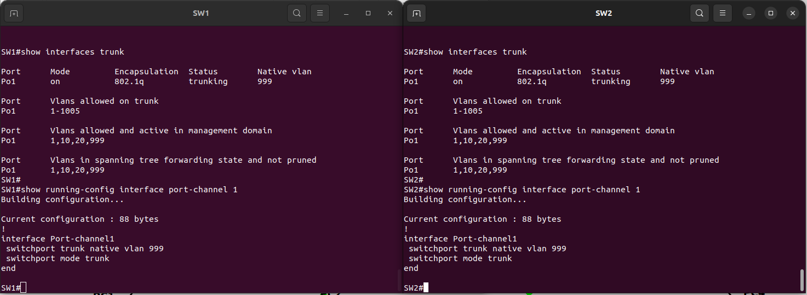

### 4.5. Проверка связности

После настройки EtherChannel повторно проверена связность между виртуальными компьютерами, расположенными в одинаковых VLAN на разных коммутаторах.

Результаты ICMP-проверок:

- PC1 ↔ PC3 — успешно.
- PC2 ↔ PC4 — успешно.

**Результаты проверки:**

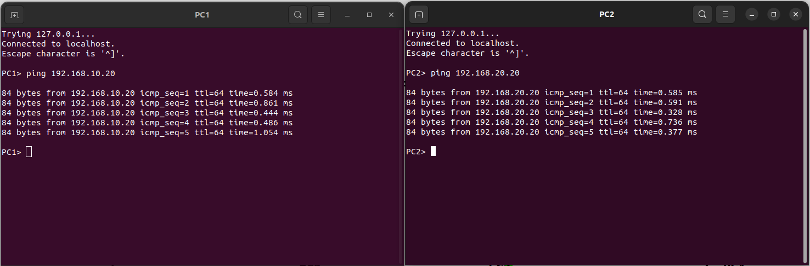

### 4.6. Результат

Настроен EtherChannel между двумя коммутаторами с использованием двух физических интерфейсов.

Проверены состояние агрегированного канала, работа trunk и сохранение сетевой связности между устройствами.

---

## 5. OSPF Dynamic Routing

### 5.1. Цель

Настроить динамическую маршрутизацию между тремя маршрутизаторами Cisco с использованием OSPF и обеспечить обмен маршрутной информацией между удалёнными подсетями.

Дополнительно реализовать аутентификацию OSPF для защиты взаимодействия между маршрутизаторами.

### 5.2. Топология и IP-адресация

В лабораторной работе использовались три последовательно соединённых маршрутизатора: R1, R2 и R3.

Для транзитных соединений выделены две подсети:

| Соединение | Интерфейс | IP-адрес |
|---|---|---|
| R1 — R2 | R1 Fa0/0 | 10.0.12.1/30 |
| R1 — R2 | R2 Fa0/0 | 10.0.12.2/30 |
| R2 — R3 | R2 Fa0/1 | 10.0.23.1/30 |
| R2 — R3 | R3 Fa0/0 | 10.0.23.2/30 |

Дополнительно на R1 и R3 созданы Loopback0:

| Маршрутизатор | Loopback0 | Подсеть |
|---|---|---|
| R1 | 192.168.1.1/24 | 192.168.1.0/24 |
| R3 | 192.168.3.1/24 | 192.168.3.0/24 |

OSPF настроен в Area 0.

**Топология:**

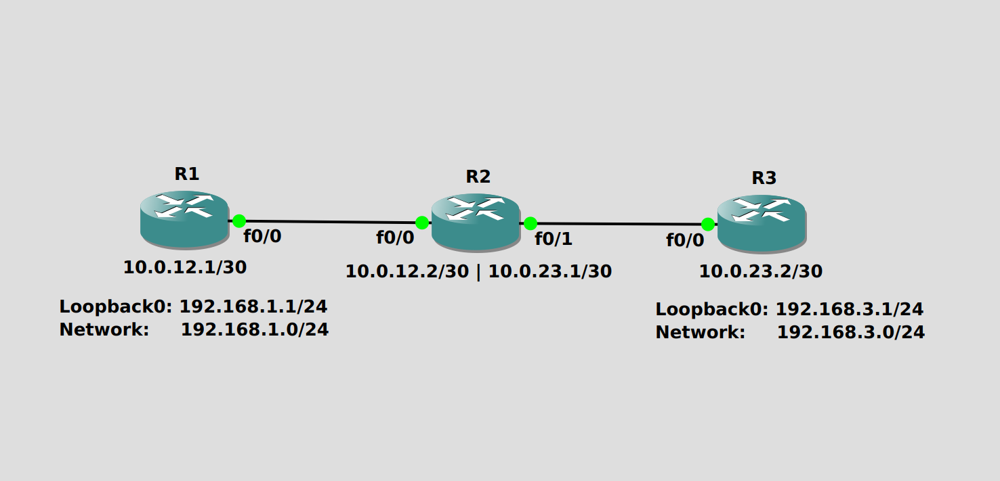

### 5.3. Настройка и проверка соседских отношений

После настройки OSPF проверены соседские отношения между маршрутизаторами.

Использована команда:

```text
show ip ospf neighbor
```

Результаты проверки:

- R1 установил соседство с R2.
- R2 установил соседства с R1 и R3.
- R3 установил соседство с R2.

Соседские отношения достигли состояния `FULL`.

**Результаты проверки:**

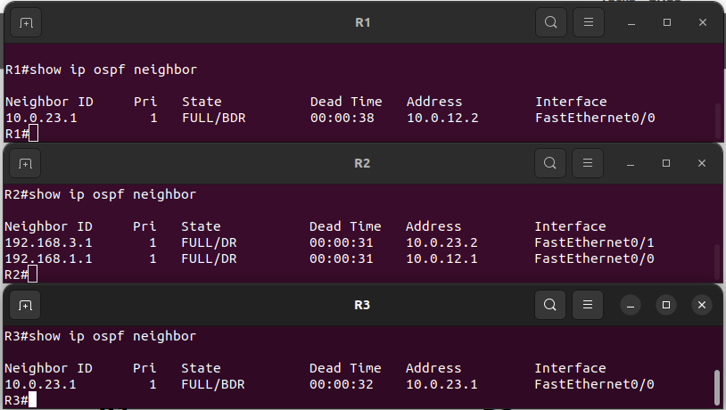

### 5.4. Проверка таблиц маршрутизации

Для проверки распространения маршрутной информации использованы команды:

```text
show ip route
show ip route ospf
```

В таблицах маршрутизации проверено наличие удалённых подсетей, полученных через OSPF.

На R1 присутствует маршрут к сети `192.168.3.0/24`.

На R3 присутствует маршрут к сети `192.168.1.0/24`.

Маршруты обозначены кодом `O`, указывающим на их получение через OSPF.

**Результаты проверки:**

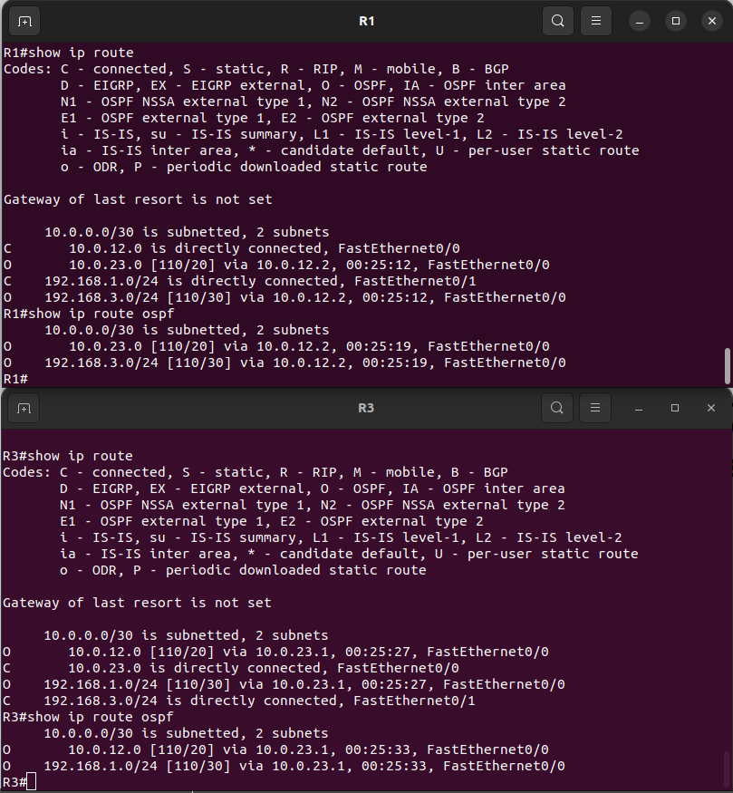

### 5.5. OSPF MD5 Authentication

Дополнительно настроена аутентификация OSPF с использованием MD5 Message Digest Authentication.

На интерфейсах, участвующих в соответствующем OSPF-соединении, включена аутентификация и задан ключ.

Пример используемых команд:

```text
interface FastEthernet0/0
 ip ospf authentication message-digest
 ip ospf message-digest-key 1 md5 <KEY>
```


Проверка выполнена с помощью:

```text
show ip ospf interface
show running-config | include ospf
```

В выводе `show ip ospf interface` подтверждено включение Message Digest Authentication.

**Результат проверки:**

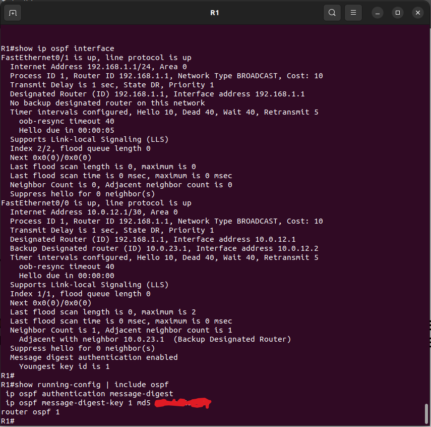

### 5.6. Проверка связности

Для проверки доступности удалённых подсетей выполнены ICMP-запросы между Loopback-интерфейсами R1 и R3.

На R1:

```text
ping 192.168.3.1
```

На R3:

```text
ping 192.168.1.1
```

В обоих направлениях получено 5 успешных ответов из 5 отправленных пакетов.

**Результаты проверки:**

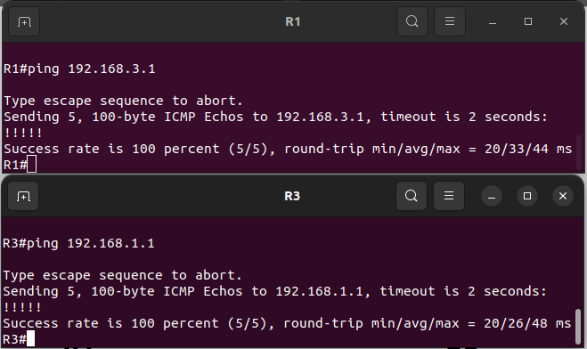

### 5.7. Результат

Настроена динамическая маршрутизация OSPF между тремя маршрутизаторами.

Установлены соседские отношения, проверено распространение маршрутной информации и доступность удалённых подсетей. Дополнительно реализована MD5-аутентификация OSPF.

---

## 6. HSRP Gateway Redundancy

### 6.1. Цель

Настроить резервирование шлюза с использованием HSRP и проверить переключение между основным и резервным маршрутизаторами при отказе активного устройства.

### 6.2. Топология и IP-адресация

В лабораторной работе использовались:

- Два маршрутизатора Cisco — R1 и R2.
- Коммутатор Switch1.
- Виртуальный компьютер PC1.

Все устройства находятся в одной подсети `192.168.1.0/24`.

| Устройство | IP-адрес |
|---|---|
| R1 | 192.168.1.2/24 |
| R2 | 192.168.1.3/24 |
| HSRP Virtual IP | 192.168.1.1/24 |
| PC1 | 192.168.1.10/24 |

**Топология:**

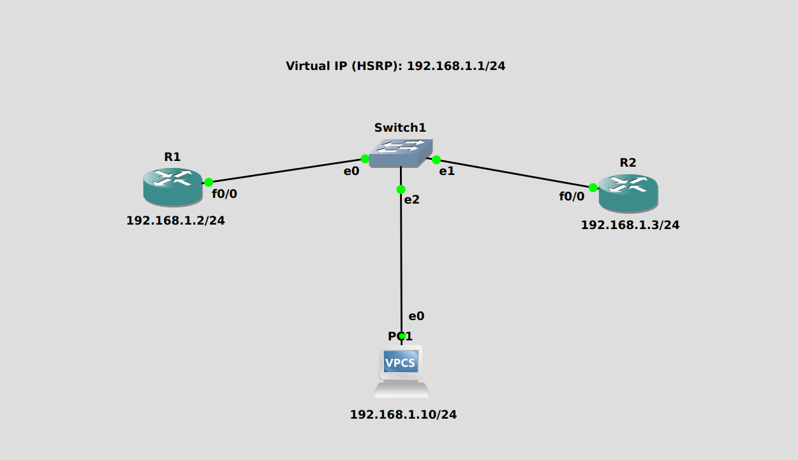

### 6.3. Настройка HSRP

На обоих маршрутизаторах настроен HSRP с использованием одной группы и общего виртуального IP-адреса `192.168.1.1`.

Настроены приоритеты маршрутизаторов:

- R1 — приоритет 110.
- R2 — приоритет 100.

Для выбора активного маршрутизатора и автоматического возвращения к нему после восстановления настроен механизм preempt.

Основные команды проверки:

```text
show standby
show standby brief
```

В результате проверки:

- R1 находится в состоянии Active.
- R2 находится в состоянии Standby.
- Оба маршрутизатора используют общий виртуальный IP-адрес.

**Состояние HSRP:**

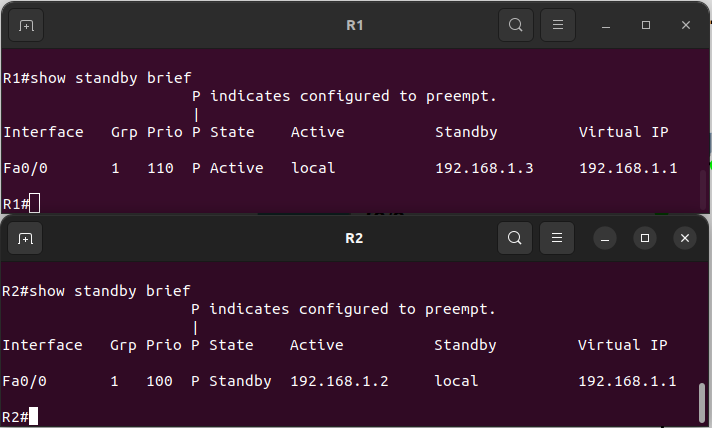

### 6.4. Проверка конфигурации

Для просмотра параметров HSRP использованы команды:

```text
show standby
show running-config
```

Проверены виртуальный адрес, номер группы, приоритеты и параметры переключения.

**Результаты проверки:**

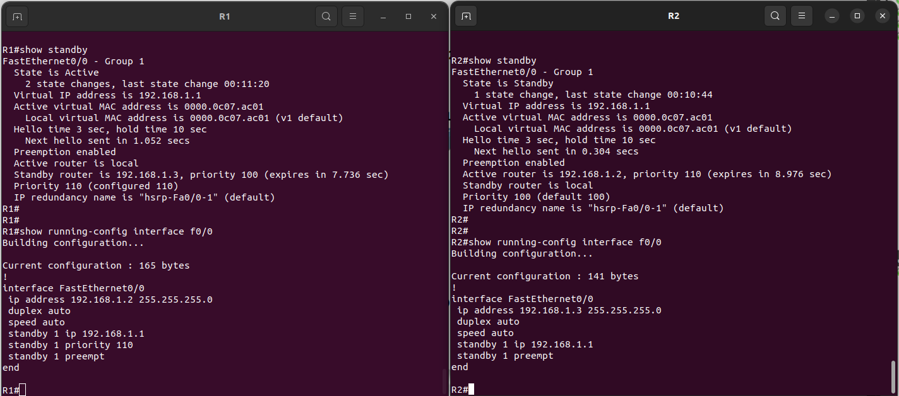

### 6.5. Проверка доступности виртуального шлюза

На PC1 проверены сетевые параметры и доступность виртуального IP-адреса HSRP.

Использованы команды:

```text
show ip
ping 192.168.1.1
```

Виртуальный шлюз успешно отвечает на ICMP-запросы.

**Результаты проверки:**

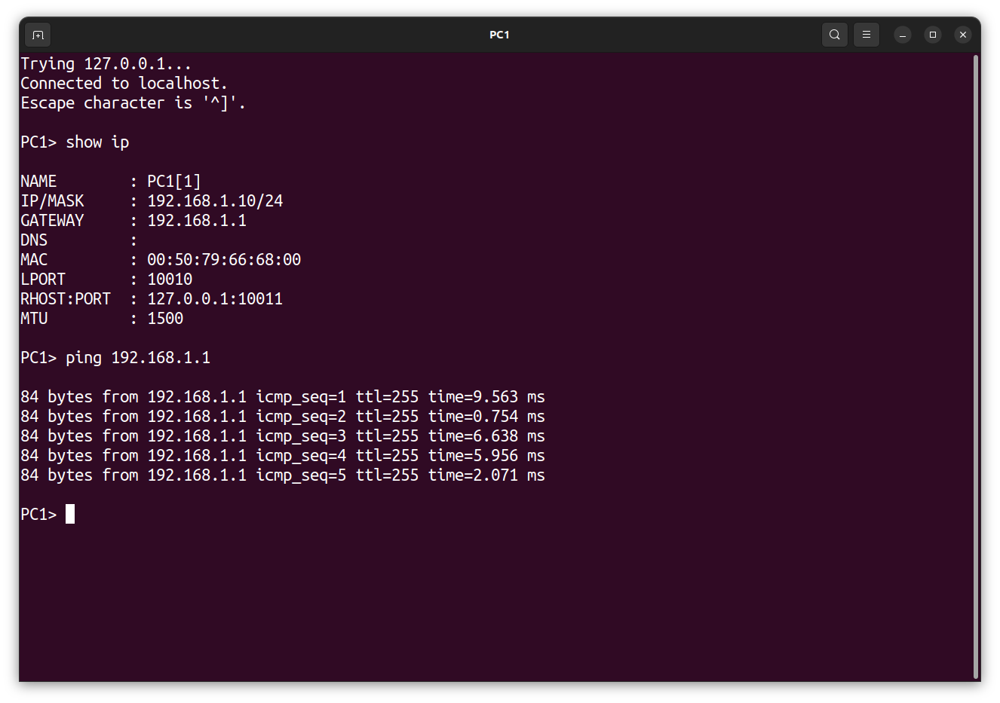

### 6.6. Проверка переключения Active/Standby

Для проверки отказоустойчивости в лабораторной среде отключён интерфейс активного маршрутизатора R1.

После отключения проверено состояние HSRP на R2.

R2 автоматически перешёл из состояния Standby в Active и стал обслуживать виртуальный IP-адрес.

Дополнительно с PC1 повторно проверена доступность виртуального шлюза.

Во время переключения наблюдалась кратковременная потеря ICMP-пакета, после чего связь восстановилась.

После проверки интерфейс R1 был возвращён в рабочее состояние.

**Результаты проверки:**

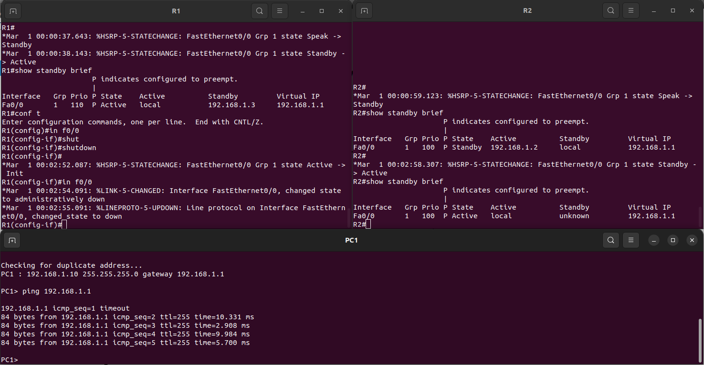

### 6.7. Результат

Настроено резервирование шлюза с использованием HSRP.

Проверены состояния Active и Standby, доступность виртуального IP-адреса и автоматическое переключение на резервный маршрутизатор при отказе активного интерфейса.

---

## 7. Анализ сетевой инфраструктуры и применение в SOC

В рамках проекта изучены механизмы, которые используются при построении и защите корпоративных сетей.

| Технология | Значение для сетевой безопасности |
|---|---|
| VLAN | Логическая сегментация сети и разделение широковещательных доменов |
| IEEE 802.1Q | Передача трафика нескольких VLAN через trunk-соединения |
| VLAN Security | Снижение риска атак, связанных с неправильной конфигурацией VLAN |
| EtherChannel | Агрегация физических соединений и повышение устойчивости канала |
| OSPF | Динамический обмен маршрутной информацией между маршрутизаторами |
| OSPF Authentication | Аутентификация сообщений OSPF между маршрутизаторами |
| HSRP | Обеспечение резервирования шлюза и сохранение доступности сети |

Понимание нормальной работы этих механизмов важно для анализа сетевой инфраструктуры, проверки конфигураций оборудования и исследования возможных отклонений в сетевом поведении.

Полученные знания могут применяться при анализе сетевых инцидентов и оценке конфигурационной безопасности инфраструктуры.

Внедрение SIEM, IDS/IPS и разработка правил обнаружения угроз в рамках данного проекта не выполнялись.

## 8. Итоговые результаты

В ходе выполнения проекта:

- Созданы и настроены VLAN 10 и VLAN 20.
- Настроены access- и trunk-порты с использованием IEEE 802.1Q.
- Реализована дополнительная конфигурация trunk с native VLAN 999.
- Настроен EtherChannel с объединением двух физических интерфейсов.
- Проверена работа логического Port-channel и trunk.
- Настроена динамическая маршрутизация OSPF между тремя маршрутизаторами.
- Проверены соседские отношения OSPF и распространение маршрутов.
- Настроена MD5-аутентификация OSPF.
- Настроено резервирование шлюза с использованием HSRP.
- Проверено автоматическое переключение Active/Standby при отказе активного интерфейса.
- Результаты лабораторных работ сохранены в виде проектов GNS3 и скриншотов.

## 9. Полученные навыки

- Настройка и сегментация локальных сетей с использованием VLAN.
- Конфигурирование trunk-соединений и IEEE 802.1Q.
- Базовые меры защиты VLAN.
- Настройка и диагностика EtherChannel.
- Конфигурирование динамической маршрутизации OSPF.
- Проверка соседских отношений и таблиц маршрутизации.
- Настройка OSPF Message Digest Authentication.
- Конфигурирование HSRP и проверка отказоустойчивости.
- Диагностика сетевых соединений с помощью Cisco IOS CLI и ICMP.

